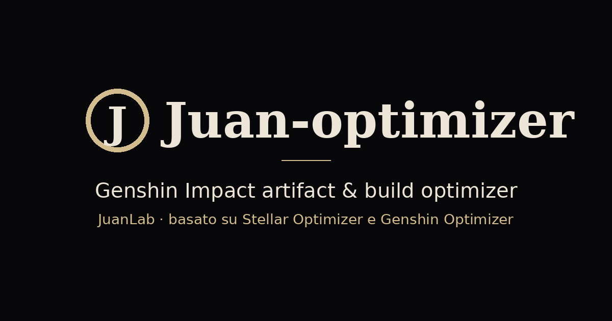

  

  <a href="https://stellaroptimizer.com/"><b>stellaroptimizer.com</b></a> ·
  <a href="https://gi-beta73.github.io/">Beta site</a> ·
  <a href="CHANGELOG.md">Changelog</a> ·
  <a href="https://github.com/s-naveen/stellar-optimizer/releases">Releases</a>

# Stellar Optimizer

Stellar Optimizer is a free, open-source build optimizer for [Genshin Impact](https://genshin.hoyoverse.com/). It finds the best artifacts and weapons for your characters and whole teams from your own inventory, and shows how a team's rotation plays out, hit by hit.

Everything runs in your browser. Your characters, weapons and artifacts are saved on your device, and you can export them as a GOOD file at any time to back them up or move them.

## What it does

- **Optimize**: searches your artifacts for a character's best build, with your own stat requirements and set rules.
- **Team optimize**: optimizes a whole team's artifacts and weapons together for the team's damage over its rotation. Each artifact goes to one member, and support sets are judged by what they add to the team.
- **Write rotation**: type a rotation such as `Bennett E Q -> Xiangling Q E -> ...` and get the attacks, hits, buffs and rotation time, simulated from frame data with cooldowns and cancels.
- **KQM Theorycrafting**: ranks weapons and artifact sets for a team using KQM-standard substats instead of your own artifacts, and shows each member's share of the damage.
- **Energy Recharge**: works out each member's Energy Recharge needs from the written rotation.
- **Enemies**: pick a Stygian Onslaught boss, or give a custom enemy's HP and resistances, and see how long the team takes to defeat it on a fight timeline.
- **Improve and Theorycraft**: see which artifact upgrades help most, and try builds with chosen substats.
- **Share**: save build cards and team cards as pictures.

To get started, import your account from a scanner that exports the [GOOD format](/libs/gi/good/), or add items by hand or from screenshots with the built-in artifact scanner.

## Thanks

Stellar Optimizer would not exist without these people and projects:

- **[Genshin Optimizer](https://github.com/frzyc/genshin-optimizer)**: frzyc and the whole Genshin Optimizer team and contributors. This project is built on their work: the database, the character, weapon and artifact sheets, the calculation engine and the optimizer.
- **[gcsim](https://github.com/genshinsim/gcsim) and [kqmsim](https://github.com/KQM-git/kqmsim)**: their maintainers, team and contributors. The rotation simulator's frame data, hitmarks and ICDs come from their work, and we check our results against their simulations.
- **The JStern Mains (JSM) Discord**: for their help with game mechanics and testing.
- **[KQM](https://keqingmains.com/)**: the KQM Theorycrafting tab follows KQM's theorycrafting standards.
- **[Inventory Kamera](https://github.com/Andrewthe13th/Inventory_Kamera)**: its creator trained and provided the tesseract model for the artifact scanner.
- **[stygian.moe](https://stygian.moe/) and the [Genshin Impact Wiki](https://genshin-impact.fandom.com/)**: Stygian Onslaught boss HP and mechanics.
- **[Nx](https://nx.dev)**: the workspace and build system.

## License

Stellar Optimizer is licensed under the [GNU Affero General Public License v3.0](/LICENSE) or later. The original Genshin Optimizer code's copyright and permission notice is kept in [LICENSE-GENSHIN-OPTIMIZER](/LICENSE-GENSHIN-OPTIMIZER). The rotation simulator's frame data is adapted from gcsim and kqmsim, which are AGPLv3 too. Anyone using a copy of the site must be able to get its source: this repository, at the tag of the deployed release. The copyright notice is in [NOTICE](/NOTICE).

## Development

### Setup

Install `yarn` ([link](https://yarnpkg.com/getting-started/install)), then run `yarn` to install dependencies.

Run `yarn run nx serve frontend` for a dev server, then open [http://localhost:4200](http://localhost:4200). The app reloads when you change a source file. `yarn test` runs every project's tests.

### Code structure

The project is an [Nx](https://nx.dev) monorepo.
The website is in [/apps/frontend](/apps/frontend/), and the libraries it uses are in [/libs](/libs/): Genshin code in [/libs/gi](/libs/gi/), shared code in [/libs/common](/libs/common/).

For an interactive view of how the projects depend on each other, run `yarn run nx graph`.

- [`frontend`](/apps/frontend/): the Stellar Optimizer website, a static site built with React and MUI, using the Waverider (WR) calculation engine.
- [gi-good](/libs/gi/good/): the Genshin Open Object Description (GOOD), the import format for Genshin scanners.
- [gi-wr](/libs/gi/wr/): the calculation engine used by the website.
- [gi-solver](/libs/gi/solver/): the artifact optimizer.
- [gi-stats](/libs/gi/stats/): Genshin numbers and values extracted from the game data by the pipeline.

### Releases

Every deploy of the site is a release: [CHANGELOG.md](/CHANGELOG.md) and the [GitHub releases](https://github.com/s-naveen/stellar-optimizer/releases) list what each one brought. The app shows the same notes on its home page and when you click the version in the footer. They come from `libs/gi/ui/src/changelog/changelog.json`; `node tools/site/release.mjs draft` proposes the next release from the commits.
